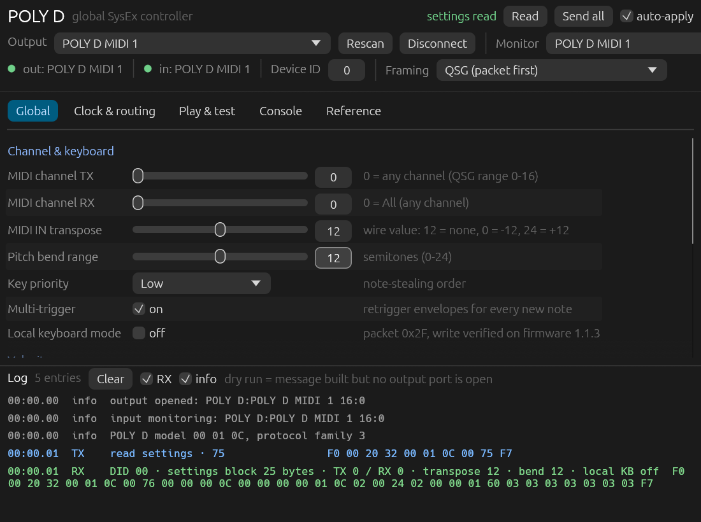
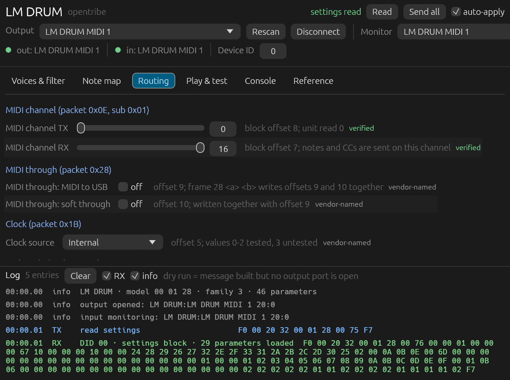
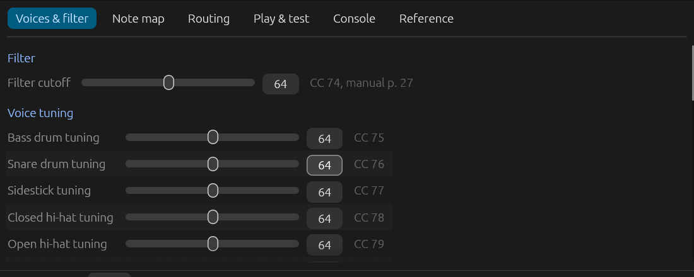
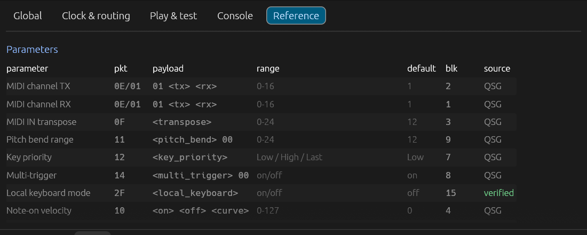
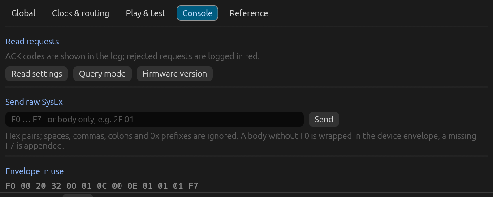
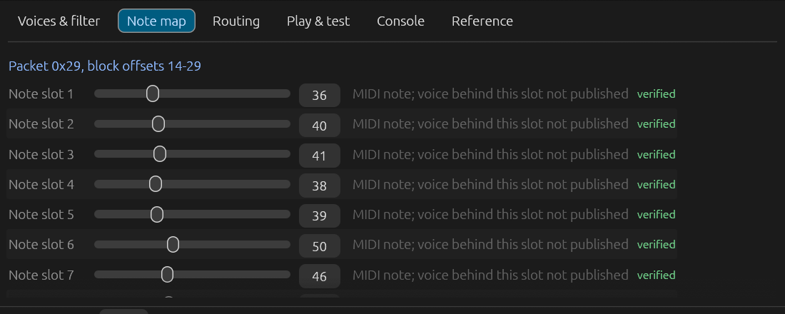
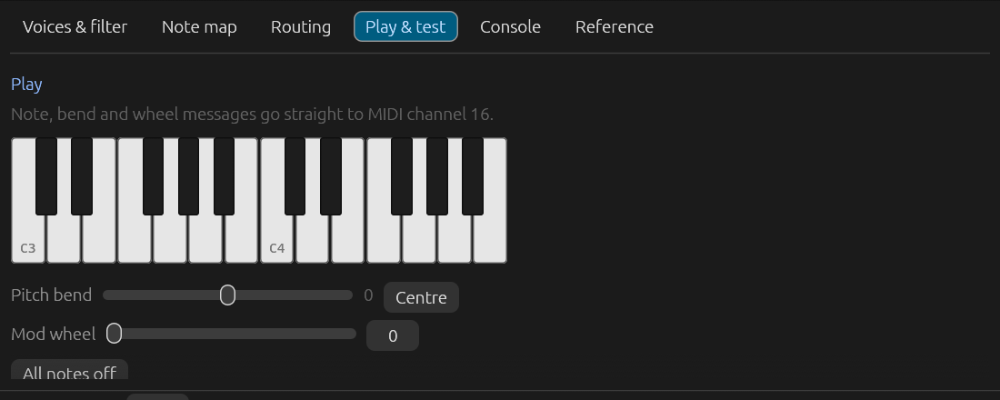
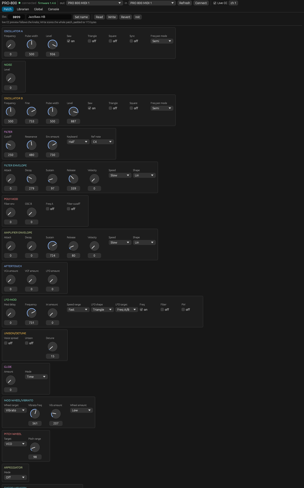
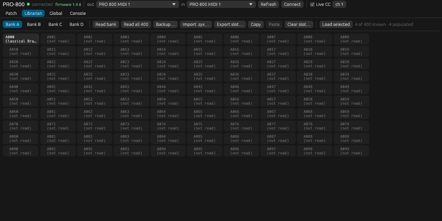

<div align="center">

# opentribe

**Descriptor-driven controllers for Behringer / Music Tribe synthesizers.**

POLY D, LM DRUM and PRO-800 today — a new descriptor device is data, not a new app.

[](https://github.com/hansfbaier/opentribe/actions/workflows/ci.yml)
[](#license)
[](https://www.rust-lang.org)




</div>

`opentribe` drives Behringer synthesizers from one `egui` application per instrument, with a
shared core. Two device styles share the shell: descriptor-driven parameter maps (POLY D and
LM DRUM) and whole-patch editors (PRO-800), which read a program, edit bytes and write the
program back. Both log every message, expose a headless CLI, and keep an evidence tag on every
fact. The descriptor devices also speak MCP.

Everything marked *verified* below was written to hardware, read back, and restored — the raw
transcripts are in [`verified/`](verified/).

---

## Why another editor

- **Descriptors, not screens.** Parameters, write groups, read-back offsets, tabs and sections
  are data. `tribe-core` renders them; a device crate only supplies facts.
- **Whole patches where the device needs them.** The PRO-800 has no per-parameter write
  frame, so its editor mutates one program record and sends the whole record back.
- **Read-modify-write.** `set` reads the block first, so changing one field never clobbers the
  others that share its message.
- **ACK-aware.** Every write's acknowledgement is decoded and shown; per-device rejection rules
  are part of the descriptor, not hard-coded.
- **Evidence tags.** Each parameter is labelled `QSG` (documented), `verified` (exercised on
  hardware), `vendor-named` (measured address, config-derived name) or `rejected`.
- **One binary per device.** No instrument you don't own is linked in. GUI, CLI, JSON and MCP
  all live in the same binary.
- **Generated and checked.** `cargo run -p xtask -- --check` fails when a committed descriptor
  is stale.

## Instruments

| Instrument | Firmware | SysEx surface | CC surface | Status |
| --- | --- | --- | --- | --- |
| **POLY D** | 1.1.3 | 21 write groups, 25-byte read-back block | none published | Global, clock, MIDI routing, play test |
| **LM DRUM** | 1.1.7 | 31 write groups, 108-byte read-back block | CC 74–90 | Voices, note map, channel, routing, switches, play test |
| **PRO-800** | 1.4.6 | 400 whole-patch programs (`77`/`78`), 40-byte global block | Swumpf editor map, live CC | Editor, librarian, globals read, console |

LM DRUM coverage: filter cutoff and 16 voice tunings (documented CCs), accent threshold, note
map, MIDI channel, MIDI through, clock source and rate, end mode, three trigger outputs and the
`74` switches (auto save, beep, random closed hat, sample mode). The **Samples** tab is
read-first: on connect it asks the device which slots are empty and which hold a sample
(slots show *not read* until that frame is captured), and it imports and exports WAV files
into the slots locally (mono 16-bit, any WAV encoding `hound` reads); transfer to and from
the instrument waits for captured transfer frames. The **Note map** tab loads and saves its 16
slots as a plain-text file (`slotNN = note` lines, `#` comments, numbers or note names such as
`C2`/`C#2`/`Db2`); loading fills the sliders and stages the change, and **Send all** writes it.

PRO-800 coverage: the **Patch** tab is a port of the Swumpf browser editor (v114): oscillators
A and B, noise, filter, both envelopes, poly-mod, aftertouch, LFO-mod, unison and chord memory,
glide, mod wheel/vibrato, pitch wheel and arpeggiator. Dragging a knob sends the same MIDI CC
the browser editor sends, so a change is audible before it is stored; **Write** is a
whole-patch read-modify-write, padded to 173 bytes, acknowledged, then read back and compared.
**Clear slot** sends the no-payload delete frame and confirms the slot reads empty. The **Librarian** scans the four
100-program banks, imports and exports `.syx`, and writes a backup with `manifest.csv`. The
**Global** tab writes active voices, note priority and transpose and shows the other global
fields read-only. Parameter offsets come from the Swumpf map and carry `vendor-named`; only the
name field and the pitch-bend range are hardware-verified. Gates G2 and G3 in
[`docs/spec-pro-800.md`](docs/spec-pro-800.md) still apply.

## Screenshots

<table>
  <tr>
    <td width="50%"><br><sub><b>LM DRUM</b> — measured routing frames, decoded ACKs, live log</sub></td>
    <td width="50%"><br><sub><b>LM DRUM</b> — documented CC surface for filter and voice tuning</sub></td>
  </tr>
  <tr>
    <td><br><sub><b>POLY D</b> — packet, payload template, range, read-back offset, evidence</sub></td>
    <td><br><sub><b>POLY D</b> — read requests, raw SysEx sender, envelope preview</sub></td>
  </tr>
  <tr>
    <td><br><sub><b>LM DRUM</b> — 16 note slots, one write group, offsets 14–29</sub></td>
    <td><br><sub><b>Play &amp; test</b> — on-screen keyboard, bend, mod wheel, panic</sub></td>
  </tr>
  <tr>
    <td><br><sub><b>PRO-800</b> — the Swumpf control surface, ported to egui</sub></td>
    <td><br><sub><b>PRO-800</b> — 400-slot librarian, bank scan and <code>.syx</code> import</sub></td>
  </tr>
</table>

## Quick start

Linux needs ALSA headers and the regular X11/Wayland client libraries:

```sh
sudo apt-get install libasound2-dev pkg-config libxkbcommon-dev
```

Build and run the GUI (it auto-selects the port and reads the settings):

```sh
cargo run --release                     # binary: opentribe — the LM DRUM controller
cargo run --release -p tribe-poly-d     # binary: opentribe-poly-d
cargo run --release -p tribe-lm-drum    # binary: opentribe-lm-drum
cargo run --release -p tribe-pro-800    # binary: opentribe-pro-800
```

The renderer is wgpu (DX12/Vulkan with a software fallback), so the GUI also
runs on machines without OpenGL drivers and on plain Linux desktops.

With no arguments the GUI starts. The app never writes during connect; edits are sent when
**auto-apply** is on, or in batches with **Send all**.

## Headless interface

Both binaries expose the same commands:

```sh
opentribe-lm-drum list-ports
opentribe-lm-drum params --json
opentribe-lm-drum read --json
opentribe-lm-drum get clock.source
opentribe-lm-drum set autosave off
opentribe-lm-drum set trigger.main Cowbell
opentribe-lm-drum send "74 09 01"
opentribe-lm-drum monitor --json --duration-ms 1000
opentribe-lm-drum mcp
```

The PRO-800 binary has its own commands around whole programs:

```sh
opentribe-pro-800 list-ports
opentribe-pro-800 status --json
opentribe-pro-800 slots --bank B
opentribe-pro-800 dump B094 --out B094.syx
opentribe-pro-800 backup --dir backups/pro800
opentribe-pro-800 inspect --file B094.syx --json
opentribe-pro-800 diff A000 B094
opentribe-pro-800 store --file B094.syx --slot C010
opentribe-pro-800 restore --dir backups/pro800
opentribe-pro-800 delete --slot C010
opentribe-pro-800 get filter.cutoff --slot B094
opentribe-pro-800 set filter.cutoff 640 --slot B094
opentribe-pro-800 globals
opentribe-pro-800 globals-set global.note_priority high
opentribe-pro-800 monitor --duration-ms 3000
```

| Flag | Meaning |
| --- | --- |
| `--port <substring>` | pick a MIDI port by name (default: the descriptor's hint) |
| `--device-id <0-127>` | SysEx device ID |
| `--json` | machine-readable output for `params`, `read`, `get`, `monitor` |
| `--dry-run` | print the message without opening the device |
| `--screenshot <file.png>` | start the GUI, save the window's picture after ~120 frames and exit |

`set` accepts numbers, enum labels (case-insensitive) and `on`/`off`, prints the exact `tx`
bytes and the `rx` ACK, and reads the settings block first so the other fields of the same
write group keep their current values.

`mcp` speaks MCP over stdio with six tools — `list_params`, `read_all`, `get_param`,
`set_param`, `send_sysex`, `monitor` — so an agent can drive the instrument the same way the
GUI does.

## Firmware updates

`opentribe-update` replays the vendor `.syx` firmware streams for PRO 800, POLY D, LM DRUM,
CRAVE and MODEL D. It sends the file byte for byte at the vendor pace rather than rebuilding
messages, because the vendor application does exactly that and the header fields are not fully
understood.

```sh
cargo run -p tribe-update -- devices
cargo run -p tribe-update -- inspect --file pro800_1.4.6.syx
cargo run -p tribe-update -- status --device pro-800
cargo run -p tribe-update -- flash --device pro-800 --file pro800_1.4.6.syx          # plan only
cargo run -p tribe-update -- flash --device pro-800 --file pro800_1.4.6.syx --send   # writes
```

| Step | What it does |
| --- | --- |
| `inspect` | parses the stream offline: message count, MD5, segments, packet counters, payload bytes, and which device the file addresses |
| `status` | sends `0x02` and `0x08 00`, prints mode and firmware version — read-only |
| `flash` (no `--send`) | prints the validated plan: device, MD5, prelude frames, pace, time estimate |
| `flash --send` | mode query → `03 30` → wait for the bootloader port → replay at 10 ms/message → report ACKs |

Safety rails: the file must match the device's model bytes or the plan is refused; `--md5`
refuses a file whose digest differs from the one you expect; `--no-reboot` refuses to send to a
unit that does not report bootloader mode; and no firmware is written without `--send`.

Device coverage and what is *not* verified:

| Device | Firmware flavour | Status |
| --- | --- | --- |
| PRO 800 | `0A` header + `0B` packets, 255-byte messages | file parses, plan validated, transfer unverified |
| POLY D | same, 308-byte messages, 3 segments | same |
| LM DRUM | same, 308-byte messages, single 1.5 MB segment | same |
| CRAVE | family 1 short envelope, 526-byte messages | same |
| MODEL D | INNO bootloader `5A` commands, 523-byte blocks | same |
| NEUTRON | STM32 USB DFU (libusb, not SysEx) | listed, not driven |

No unit has been flashed with this tool. The bootloader MIDI port has never been observed on
Linux, so the reboot-and-reconnect step is the first thing to check on hardware. Keep the
vendor updater available as a fallback: a unit left in bootloader mode needs a successful
transfer, and the vendor tool is the known-good path.

## How it works

```text
verified/<device>.toml          hand-written: wire addresses, slots, read offsets, evidence
        │
        │  cargo run -p xtask   (validates, denies unknown fields)
        ▼
crates/<device>/src/descriptors.rs     generated, committed, stale-checked in CI
        │
        ▼
tribe-core  ──  sysex envelope + framing, MIDI I/O, log, egui shell, widgets, CLI, MCP
        │
        ├── opentribe-poly-d     lib + binary
        ├── opentribe-lm-drum    lib + binary
        └── tribe-update ── opentribe-update   firmware replay (no descriptor needed)
```

A descriptor is a list of `Param`s and `WriteGroup`s. A write group is an address (packet,
packet + sub-index, or CC) plus a slot list, where each slot is a literal byte or a parameter
reference — so `0E 01 <tx> <rx>`, `11 <value> 00`, `28 <a> <b>` and `74 0A <0|1>` are all just
data. `Param`s carry a tab, a section, a widget kind (`Byte`, `Bool`, `Enum`), a read-back
offset and an evidence tag; the shell derives the whole UI from them.

Adding an instrument: one crate, one overlay, one `main.rs`, its own tests. No shell changes.

## Verified protocol

<details>
<summary><b>POLY D — firmware 1.1.3</b></summary>

| Finding | Evidence |
| --- | --- |
| `0x75` returns `0x76` + 25-byte block; all 24 offsets measured | write + read-back, restore |
| QSG framing accepted, `0x78` long envelope rejected (ACK 5) | `11 0C 00` vs `78 11 0C 00` |
| ACK `01 00 00` accepted, `01 00 05` rejected | every write in the session |
| Local keyboard mode `2F` (absent from the QSG) writes offset 15 | `2F 01`/`2F 00`, `2F 02` rejected |
| Accent threshold `1C` writes offset 17 | `1C 64` |
| `1D`, `1F` and SynthTribe's `0x77` reads are rejected | ACK 5 |

</details>

<details>
<summary><b>LM DRUM — firmware 1.1.7</b></summary>

| Finding | Evidence |
| --- | --- |
| `0x75` returns `0x76` + 108-byte block; offsets mapped one packet at a time | 31 block-backed parameters |
| Channel `0E 01 <tx> <rx>` → offsets 8/7; sub 02–05 write TX only | swap test |
| Note map `29` + 16 bytes → offsets 14–29 | write + read-back |
| MIDI through `28 <a> <b>` → offsets 9/10 (not a sub-index container) | two-field frame |
| Clock source `1B` → 5, clock rate `1A` → 6 (only 99–104 accepted) | acceptance sweep |
| Sample mode `74 0A` → 54; `74 09`/`0B`/`0C` → 35/2/31 | container sweep |
| Trigger outputs `2C` subs 0–2 → 32–34, values are 0-based voice indices | baseline `0A 0B 0E` = Cabasa/Tambourine/Cowbell |
| Settings persist across a power cycle; no save command | 109 → 100 survived a cycle |
| No writer found for offsets 11/12, 55, 72/73 and the voice map (56–71) | `0x31`–`0x4F` sweep, negative |

</details>

Raw request/reply transcripts: [`verified/poly-d-measurements.md`](verified/poly-d-measurements.md)
and [`verified/lm-drum-measurements.md`](verified/lm-drum-measurements.md).

## Development

```sh
cargo test --workspace                     # 73 tests
cargo clippy --workspace --all-targets
cargo fmt --all -- --check
cargo run -p xtask                         # regenerate descriptors
cargo run -p xtask -- --check              # CI gate: committed output must match
```

The tests pin byte-exact frames from the vendor documentation and from the observed settings
blocks, so a descriptor change that would send different bytes fails before it reaches hardware.

## Provenance

The shipped code and data derive from the POLY D and LM DRUM vendor documentation, measurements
taken on the instruments, and the MIDI specification. No vendor binary, data file or asset is
included or read at build time; `xtask` takes only the hand-written overlays under `verified/`.

- [`PROVENANCE.md`](PROVENANCE.md) — source classes, exclusions, dependency licences, and what
  "clean room" does and does not mean here.
- [`verified/`](verified/) — overlays and measurement transcripts.

## Roadmap

- Finish the LM DRUM gaps: clock polarity, flags 55/72/73, the voice-channel map writer, and the
  note-slot → voice order.
- Capture the sample transfer frames (e.g. by recording USB traffic while the vendor app imports
  or exports a sample) and implement real transfer to and from the instrument; the local
  import/export screen already exists.
- Sequencer surface once its transfer frames are captured.
- PRO-800 next steps, per [`docs/spec-pro-800.md`](docs/spec-pro-800.md): run gate G2 for each
  parameter (write a byte, read the PERF panel) and G3 for the global write frame. Until then
  the editor shows the Swumpf map as `vendor-named` and offers no per-parameter CLI write that
  claims more.
- MCP tools for the PRO-800 binary, once the whole-patch operations have settled.

## License

Dual-licensed under either of

- Apache License, Version 2.0 ([LICENSE-APACHE](LICENSE-APACHE))
- MIT license ([LICENSE-MIT](LICENSE-MIT))

at your option.

"Behringer", "POLY D", "LM DRUM", "PRO-800" and "Music Tribe" are trademarks of their owners. This project
is not affiliated with or endorsed by the manufacturer.
