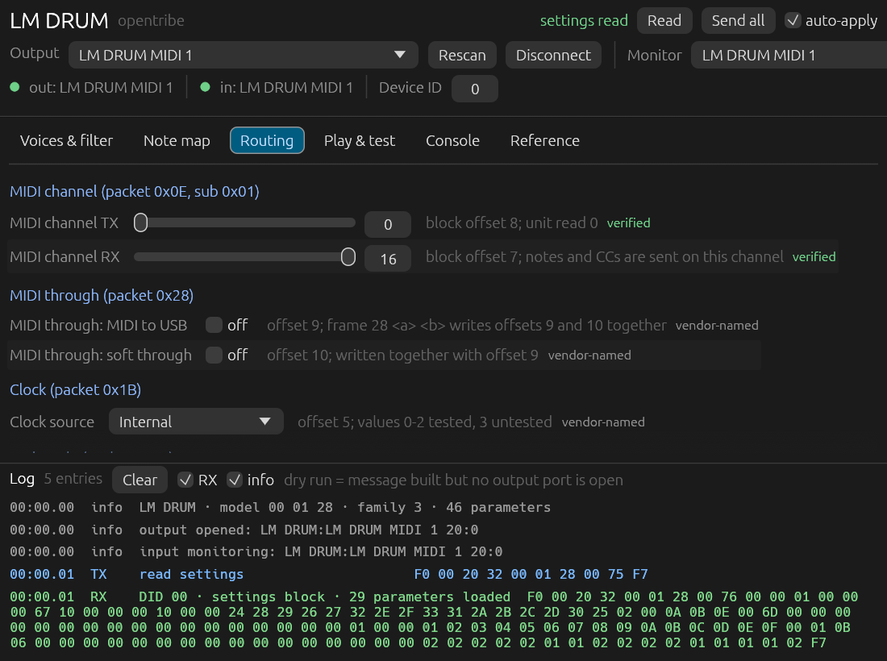

# opentribe

Descriptor-driven controllers for Behringer / Music Tribe synths, written in Rust with
`egui` + `midir`. Devices: **POLY D**, **LM DRUM**. One binary per device, one shared core.




Tested against hardware: **POLY D** (firmware 1.1.3) and **LM DRUM** (firmware 1.1.7).
Every claim marked *verified* was written to the instrument and read back.

## Build and run

```sh
cargo run --release -p tribe-poly-d      # GUI, binary opentribe-poly-d
cargo run --release -p tribe-lm-drum     # GUI, binary opentribe-lm-drum
cargo test --workspace
cargo clippy --workspace --all-targets
cargo run -p xtask                        # regenerate the POLY D descriptor
cargo run -p xtask -- --check             # CI: fail when the generated file is stale
```

Linux needs ALSA headers (`libasound2-dev` on Debian/Ubuntu). macOS and Windows build with
`midir`'s platform backend.

The app auto-selects the first MIDI port matching the descriptor's `port_hint` (`POLY D`),
opens it, and issues a settings read.

## Workspace layout

```text
Cargo.toml                  workspace (resolver 3)
crates/core/                tribe-core — sysex, descriptor model, midi, log, egui shell, widgets
crates/poly-d/              tribe-poly-d — descriptor + binary opentribe-poly-d
crates/lm-drum/             tribe-lm-drum — descriptor + binary opentribe-lm-drum
  src/descriptors.rs        generated by `cargo run -p xtask`, committed
  src/tests.rs              byte-exact checks against documentation + measured blocks
verified/poly-d.toml        hand-maintained wire facts, read offsets, evidence, notes
verified/lm-drum.toml       same for the LM DRUM (CCs + measured SysEx)
xtask/                      descriptor generator (validates overlays, emits the Rust consts)
```

Adding a device means adding one crate that supplies a `Device` descriptor, a thin `main.rs`,
and its own tests. No shell code changes.

## Descriptor model

- `Device`: model bytes, protocol family, write styles, read spec, restore packet,
  performance-channel parameter, parameters, write groups, rejected packets, notes.
- `Param`: id, title, widget kind (`Byte`, `Bool`, `Enum`), tab, section, write group,
  default, read-back offset, evidence level, hint.
- `WriteGroup`: address (packet + optional sub-packet) plus a slot list, where a slot is
  either a literal byte or a parameter reference. Channel (`0E 01 <tx> <rx>`), pitch bend
  (`11 <v> 00`) and velocity (`10 <on> <off> <curve>`) are all just slot lists.
- `Evidence`: `QSG` (printed in the manual), `Verified` (exercised on hardware),
  `Unsupported` (in the vendor config, rejected by firmware). The UI shows the tag next to
  each parameter and in the reference table.

Tabs, sections and rows are derived from the descriptor; the shell renders any device.

## LM DRUM coverage

The public manual documents the MIDI CC surface but has no SysEx packet table. The app
therefore exposes exactly what has a source:

| Area | Content | Source |
| --- | --- | --- |
| Voices & filter | CC 74 filter cutoff, CC 75-90 voice tunings, accent threshold (`1C`, offset 36) | manual p. 27, measured |
| Note map | 16 note slots at block offsets 14-29, packet `0x29` | measured |
| Routing | channel TX/RX (`0E` sub `01`), MIDI through (`28` two-field frame → offsets 9/10), clock source (`1B` → offset 5) and rate (`1A` → offset 6), end mode (`2A`), three trigger outputs (`2C` sub 0-2 → voice indices), auto save / beep / random hat / sample mode (`74` subs `0B`/`0C`/`09`/`0A`) | measured |
| Play & test | keyboard, bend, wheels, all-notes-off | generic |

`vendor-named` marks a parameter whose wire address is measured while its human name comes
from the vendor configuration; the reference tab shows the tag. Voice indices in the trigger
outputs use the manual's voice order (verified against the unit's baseline `0A 0B 0E` =
Cabasa/Tambourine/Cowbell).

Still open: the USB channel fields at offsets 11/12, clock polarity, the flags at offsets
55/72/73, the voice channel map writer, note-slot to voice order, persistence of a changed value,
and the sequencer/sample paths. See the research handoff in the RE notebook.

## POLY D findings (firmware 1.1.3)

| Finding | Evidence |
| --- | --- |
| QSG framing accepted, SynthTribe `0x78` framing rejected | `11 0C 00` → ACK 0, `78 11 0C 00` → ACK 5 |
| Every write is ACKed: `01 00 00` accepted, `01 00 05` rejected | unknown packet, out-of-range value, wrong framing |
| `0x75` returns a 25-byte settings block as `0x76` | read-back offsets confirmed one packet at a time |
| Local keyboard mode (`0x2F`) exists, flips block offset 15 | `2F 01` / `2F 00`; `2F 02` rejected |
| Accent velocity threshold (`0x1C`) lives at offset 17 | `1C 64` → offset 17 = 0x64 |
| `0x1D` and `0x1F` are rejected | ACK 5; listed under "rejected", never sent |
| SynthTribe's `0x77` reads are rejected | ACK 5 for `7E 03` and `74 03` |
| Firmware query 1.1.3, mode query normal | `09 00 01 01 03`, `03 00` |

The instrument was restored to its original block after testing. Local keyboard mode did not
survive a power cycle: it read 0 after `2F 00`, then 1 after the unit was power-cycled.

## Using it

Every edit is written immediately when **auto-apply** is on; with auto-apply off, edits
accumulate and **Send all** writes all parameter groups. Messages appear in the log whether
or not a port is open (`dry run`), so the app doubles as a message generator.

- **Global / Clock & routing** — all 24 parameters, grouped by descriptor sections.
- **Play & test** — two-octave keyboard, pitch bend, mod wheel, all-notes-off, factory restore.
- **Console** — settings read, mode and firmware queries, raw SysEx sender, envelope preview.
- **Reference** — packet, payload template, range, default, block offset and evidence per
  parameter, plus rejected packets and device notes.

## Headless interface

Both binaries expose the same commands (`opentribe-poly-d`, `opentribe-lm-drum`):

```sh
opentribe-lm-drum list-ports
opentribe-lm-drum params --json
opentribe-lm-drum read --json
opentribe-lm-drum get clock.source
opentribe-lm-drum set autosave off
opentribe-lm-drum set trigger.main Cowbell
opentribe-lm-drum send "74 09 01"
opentribe-lm-drum monitor --json --duration-ms 1000
opentribe-lm-drum mcp
```

- No arguments starts the GUI.
- `--port <substring>` and `--device-id <0-127>` select the port and the SysEx device ID.
- `set` reads the block first so the rest of the write group keeps its current value, then prints
  the message and the ACK. It accepts numbers, enum labels (case-insensitive) and on/off.
- `--dry-run` prints the message without opening the device.
- `mcp` speaks MCP over stdio with six tools: `list_params`, `read_all`, `get_param`,
  `set_param`, `send_sysex`, `monitor`.

## Roadmap

Machine interface is shipped (CLI + JSON + MCP). Next: close the remaining LM DRUM gaps listed in
the research handoff, then add the next instrument as another descriptor crate.

## Troubleshooting

- **Nothing answers after a run.** The POLY D stops replying to SysEx once the host port has
  been opened and closed many times (also observed with raw probes, and on an LM DRUM the app
  never touched). Power-cycle the instrument; the app re-reads settings on the next start.
- **A second copy** cannot share the port; the first instance wins.

## Provenance

The shipped code and data derive only from the POLY D QSG "System Exclusive Data Sheet"
(p. 82-85), from measurements taken on the instrument, and from the MIDI specification. No
vendor binary, data file or asset is included or read at build time; `cargo run -p xtask`
takes a single hand-written input, `verified/poly-d.toml`.

- `PROVENANCE.md` — source classes, exclusions, dependency licences, and what "clean room"
  does and does not mean for this project.
- `verified/poly-d-measurements.md` — the raw request/reply transcripts behind every
  `verified` tag, including the offset map.
- `crates/poly-d/src/tests.rs` — pins the wire format against the QSG examples and the
  observed settings block.
