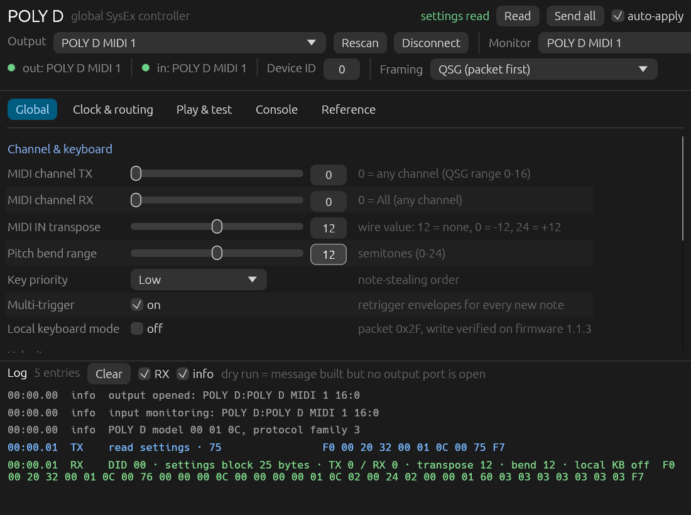

# Open POLY D

Desktop controller for the **Behringer POLY D** written in Rust with `egui` + `midir`.
It drives the global parameter SysEx map from the official QSG data sheet, reads the
current settings back from the instrument, and doubles as a small test bench
(on-screen keyboard, raw SysEx console, message log).



Tested against hardware: **POLY D, firmware 1.1.3**, model bytes `00 01 0C`, device ID `00`.
Everything in this README marked *verified* was sent to the instrument and read back.

## Build and run

Linux needs ALSA headers (`libasound2-dev` on Debian/Ubuntu) and the usual X11/Wayland
client libraries. macOS and Windows build with the `midir` platform backend.

```sh
cargo run --release
```

The app auto-selects the first MIDI port whose name contains `POLY D`, opens it, and
issues a settings read. Pick another port from the Output / Monitor dropdowns if needed.

```sh
cargo test          # 19 tests: byte-exact framing, block decoding, SysEx reassembly
cargo clippy --all-targets
```

## What it controls

22 packets are in the map; 21 are writable on firmware 1.1.3.

| Group | Controls |
| --- | --- |
| Channel & keyboard | MIDI channel TX/RX, MIDI IN transpose, pitch bend range, key priority, multi-trigger, local keyboard mode |
| Velocity | note-on constant, note-off constant, curve |
| Modulation & CV | modulation curve, mod-wheel range, note at zero CV, accent velocity threshold |
| Clock | source, rate, polarity, MIDI clock out |
| MIDI output routing | mod wheel, pitch wheel, keyboard, keyboard aftertouch, sequencer, arpeggiator |

Every edit is written immediately when **auto-apply** is on. With auto-apply off, edits
accumulate and **Send all** writes all 21 parameters. Messages are shown in the log
whether or not a port is open (`dry run`), so the app is usable as a message generator.

### Tabs

- **Global** — channel, transpose, velocity, modulation, CV, local keyboard mode.
- **Clock & routing** — clock source/rate/polarity and the six MIDI output routes.
- **Play & test** — two-octave keyboard, pitch bend, mod wheel, all-notes-off, factory restore.
- **Console** — settings read, mode/firmware queries, raw SysEx sender.
- **Reference** — packet table with read-back offsets, framing, verification notes.

## Wire format

```text
F0 00 20 32 00 01 0C 00 <packet> [<sub-packet>] <payload…> F7
│  │        │           │   │
│  │        │           │   └ packet number (config.json "pkt")
│  │        │           └───── device ID (00 matches the hardware; 0 = broadcast)
│  │        └───────────────── model ID 00 01 0C = POLY D
│  └────────────────────────── Behringer / Music Tribe manufacturer ID
└───────────────────────────── SysEx start
```

Examples (QSG data sheet, verified on hardware):

```text
channel 1/1      F0 00 20 32 00 01 0C 00 0E 01 01 01 F7
local KB on      F0 00 20 32 00 01 0C 00 2F 01 F7
pitch bend 12    F0 00 20 32 00 01 0C 00 11 0C 00 F7
read settings    F0 00 20 32 00 01 0C 00 75 F7
```

The SynthTribe binary frames writes with the long-envelope opcode `0x78` in front of the
packet number. The POLY D **rejects** that form with ACK code 5, so the app defaults to the
QSG framing; the 0x78 form stays selectable for protocol work and is labelled as rejected.

## Read-back

`0x75` (ReadEntireParameters) is the working read; the device answers with `0x76` plus a
25-byte block. The block offsets are the `index` fields from `config.json`, each confirmed
by writing one packet and re-reading the block:

```text
tx  F0 00 20 32 00 01 0C 00 75 F7
rx  F0 00 20 32 00 01 0C 00 76 00 00 00 0C 00 00 00 00 01 02 02 00 24 02 00 00 01 60 03 03 03 03 03 03 03 F7
                                     │  │  │  │  │  │  │  │  │  │  │  │  │  │  │  │  │  │  │
                                     │  │  │  │  │  │  │  │  │  │  │  │  │  │  │  │  │  │  └ output routes ×6
                                     │  │  │  │  │  │  │  │  │  │  │  │  │  │  │  │  │  └──── MIDI clock out
                                     │  │  │  │  │  │  │  │  │  │  │  │  │  │  │  │  └─────── accent threshold
                                     │  │  │  │  │  │  │  │  │  │  │  │  │  │  │  └────────── clock polarity
                                     │  │  │  │  │  │  │  │  │  │  │  │  │  │  └───────────── local keyboard mode
                                     │  │  │  │  │  │  │  │  │  │  │  │  │  └──────────────── clock source
                                     │  │  │  │  │  │  │  │  │  │  │  │  └─────────────────── clock rate
                                     │  │  │  │  │  │  │  │  │  │  │  └────────────────────── note at zero CV
                                     │  │  │  │  │  │  │  │  │  │  └───────────────────────── modulation curve
                                     │  │  │  │  │  │  │  │  │  └──────────────────────────── mod-wheel range
                                     │  │  │  │  │  │  │  │  └─────────────────────────────── pitch bend range
                                     │  │  │  │  │  │  │  └────────────────────────────────── multi-trigger
                                     │  │  │  │  │  │  └───────────────────────────────────── key priority
                                     │  │  │  │  │  └──────────────────────────────────────── velocity curve
                                     │  │  │  │  └─────────────────────────────────────────── velocity off
                                     │  │  │  └────────────────────────────────────────────── velocity on
                                     │  │  └───────────────────────────────────────────────── transpose
                                     │  └──────────────────────────────────────────────────── MIDI channel RX
                                     └─────────────────────────────────────────────────────── MIDI channel TX
```

Offsets 0, 5 and 6 are not exposed in the UI: offset 0 read as zero and 5/6 mirror the
velocity constants.

Every write is answered with an ACK: `01 00 00` = accepted, `01 00 05` = rejected
(unknown packet, out-of-range value, wrong framing). Rejections are logged in red.

## Hardware findings (firmware 1.1.3)

| Finding | Evidence |
| --- | --- |
| QSG framing accepted, `0x78` framing rejected | `11 0C 00` → ACK 0, `78 11 0C 00` → ACK 5 |
| All writes are ACKed with a success/reject code | ACK codes above |
| `0x75` returns a 25-byte settings block as `0x76` | byte dump above |
| Local keyboard mode (`0x2F`) exists and flips block offset 15 | `2F 01` → offset 15 = 1, `2F 00` → 0; `2F 02` rejected |
| Accent velocity threshold (`0x1C`) lives at offset 17 | `1C 64` → offset 17 = 0x64 |
| `0x1D` (sequencer auto-sync) and `0x1F` (assign) are rejected | ACK 5 |
| SynthTribe's `0x77` reads are rejected | ACK 5 for `7E 03` and `74 03` |
| Firmware query returns 1.1.3, mode query returns normal operation | `09 00 01 01 03`, `03 00` |

The instrument returned to its original block after testing. Local keyboard mode did not
survive a power cycle: it read 0 after `2F 00`, then 1 after the unit was power-cycled.

## Troubleshooting

- **Nothing answers after a run.** The POLY D stops replying to SysEx once the host port has
  been opened and closed many times (observed here with raw probes too, and on an LM DRUM that
  the app never touched). Power-cycle the instrument; the app reconnects and re-reads on the
  next start. Pressing **Disconnect** in the app before quitting avoids some of it.
- **A second copy of the app** cannot share the port; the first instance wins.
- **No port listed.** Check `amidi -l`; the app matches any port whose name contains `POLY D`.

## Limits

- No MIDI CC parameter map exists for the POLY D; the published control surface is SysEx only.
- Sequencer and arpeggiator pattern editing are out of scope; only their MIDI output routing is exposed.
- The 0x76 block is the only read this app decodes. Bulk dumps and other replies are logged as hex.
- Only one instance should hold the MIDI port; a second instance will fight over it.

## Code map

| File | Contents |
| --- | --- |
| `src/sysex.rs` | envelope, packet/opcode constants, message builders, parser, hex helpers |
| `src/model.rs` | parameter struct, payload builders, block decoding, reference table, reply decoder |
| `src/midi.rs` | `midir` wrapper, port discovery, SysEx reassembly from split callbacks |
| `src/app.rs` | egui UI, log, keyboard widget, read/write plumbing |
| `src/main.rs` | window setup |

## Credits

Protocol facts come from the POLY D QSG "System Exclusive Data Sheet" and the SynthTribe
3.2.4 analysis in `behringer-synthribe` (`devices/POLY-D/`).
