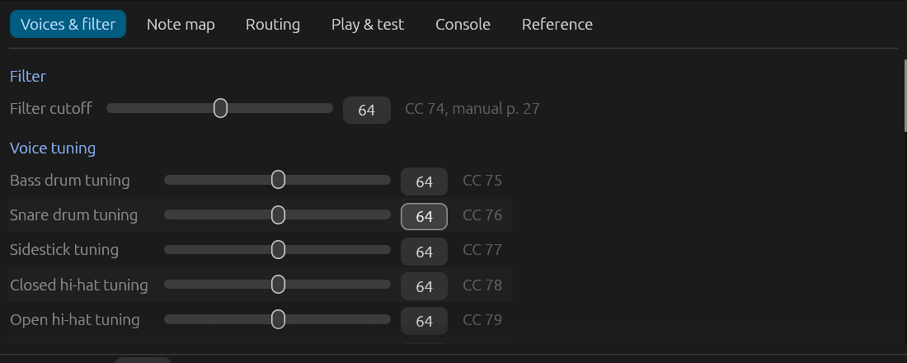
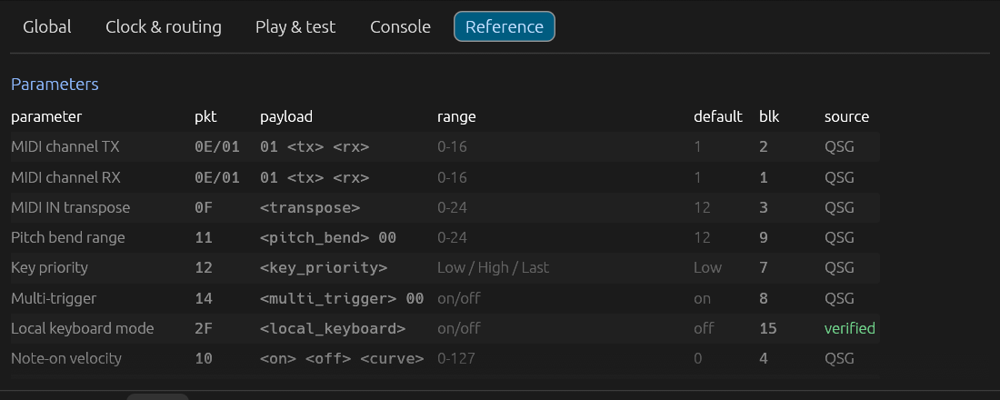
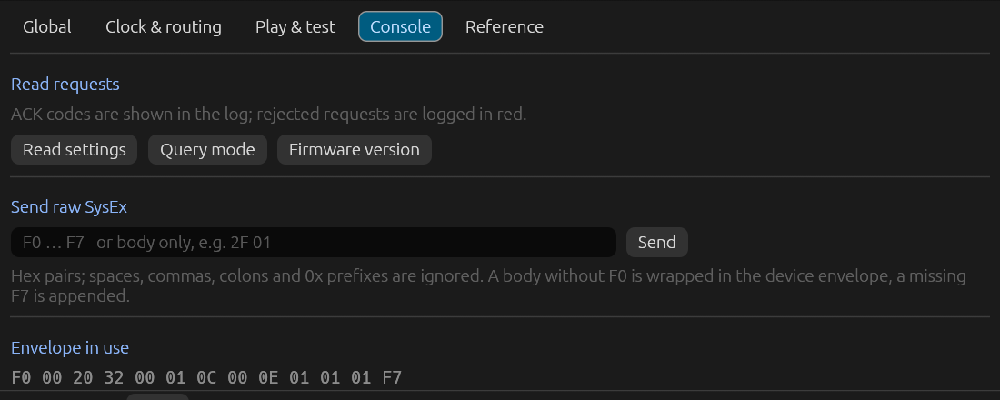
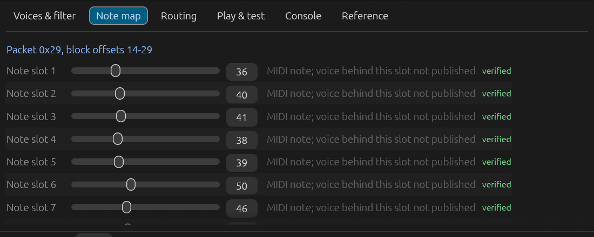
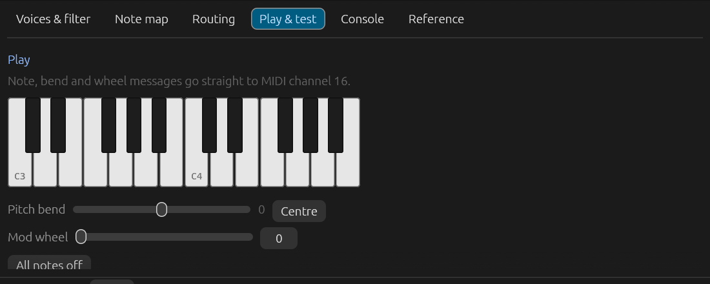

<div align="center">

# opentribe

**Descriptor-driven controllers for Behringer / Music Tribe synthesizers.**

POLY D and LM DRUM today — a new instrument is a descriptor, not a new app.

[](https://github.com/hansfbaier/opentribe/actions/workflows/ci.yml)
[](#license)
[](https://www.rust-lang.org)


</div>

`opentribe` drives the global SysEx parameter map of Behringer synthesizers from a single
`egui` application per instrument, with a shared core. It writes settings, reads them back from
the 108/25-byte parameter block, logs every message with its ACK, and ships a headless CLI and
an MCP server so scripts and agents can use the same descriptors.

Everything marked *verified* below was written to hardware, read back, and restored — the raw
transcripts are in [`verified/`](verified/).

---

## Why another editor

- **Descriptors, not screens.** Parameters, write groups, read-back offsets, tabs and sections
  are data. `tribe-core` renders them; a device crate only supplies facts.
- **Read-modify-write.** `set` reads the block first, so changing one field never clobbers the
  others that share its message.
- **ACK-aware.** Every write's acknowledgement is decoded and shown; per-device rejection rules
  are part of the descriptor, not hard-coded.
- **Evidence tags.** Each parameter is labelled `QSG` (documented), `verified` (exercised on
  hardware), `vendor-named` (measured address, config-derived name) or `rejected`.
- **One binary per device.** No instrument you don't own is linked in. GUI, CLI, JSON and MCP
  all live in the same binary.
- **Generated and checked.** `cargo run -p xtask -- --check` fails when a committed descriptor
  is stale.

## Instruments

| Instrument | Firmware | SysEx surface | CC surface | Status |
| --- | --- | --- | --- | --- |
| **POLY D** | 1.1.3 | 21 write groups, 25-byte read-back block | none published | Global, clock, MIDI routing, play test |
| **LM DRUM** | 1.1.7 | 31 write groups, 108-byte read-back block | CC 74–90 | Voices, note map, channel, routing, switches, play test |

LM DRUM coverage: filter cutoff and 16 voice tunings (documented CCs), accent threshold, note
map, MIDI channel, MIDI through, clock source and rate, end mode, three trigger outputs and the
`74` switches (auto save, beep, random closed hat, sample mode).

## Screenshots

<table>
  <tr>
    <td width="50%"><br><sub><b>LM DRUM</b> — measured routing frames, decoded ACKs, live log</sub></td>
    <td width="50%"><br><sub><b>LM DRUM</b> — documented CC surface for filter and voice tuning</sub></td>
  </tr>
  <tr>
    <td><br><sub><b>POLY D</b> — packet, payload template, range, read-back offset, evidence</sub></td>
    <td><br><sub><b>POLY D</b> — read requests, raw SysEx sender, envelope preview</sub></td>
  </tr>
  <tr>
    <td><br><sub><b>LM DRUM</b> — 16 note slots, one write group, offsets 14–29</sub></td>
    <td><br><sub><b>Play &amp; test</b> — on-screen keyboard, bend, mod wheel, panic</sub></td>
  </tr>
</table>

## Quick start

Linux needs ALSA headers and the regular X11/Wayland client libraries:

```sh
sudo apt-get install libasound2-dev pkg-config libxkbcommon-dev
```

Build and run the GUI (it auto-selects the port and reads the settings):

```sh
cargo run --release -p tribe-poly-d      # binary: opentribe-poly-d
cargo run --release -p tribe-lm-drum     # binary: opentribe-lm-drum
```

With no arguments the GUI starts. The app never writes during connect; edits are sent when
**auto-apply** is on, or in batches with **Send all**.

## Headless interface

Both binaries expose the same commands:

```sh
opentribe-lm-drum list-ports
opentribe-lm-drum params --json
opentribe-lm-drum read --json
opentribe-lm-drum get clock.source
opentribe-lm-drum set autosave off
opentribe-lm-drum set trigger.main Cowbell
opentribe-lm-drum send "74 09 01"
opentribe-lm-drum monitor --json --duration-ms 1000
opentribe-lm-drum mcp
```

| Flag | Meaning |
| --- | --- |
| `--port <substring>` | pick a MIDI port by name (default: the descriptor's hint) |
| `--device-id <0-127>` | SysEx device ID |
| `--json` | machine-readable output for `params`, `read`, `get`, `monitor` |
| `--dry-run` | print the message without opening the device |

`set` accepts numbers, enum labels (case-insensitive) and `on`/`off`, prints the exact `tx`
bytes and the `rx` ACK, and reads the settings block first so the other fields of the same
write group keep their current values.

`mcp` speaks MCP over stdio with six tools — `list_params`, `read_all`, `get_param`,
`set_param`, `send_sysex`, `monitor` — so an agent can drive the instrument the same way the
GUI does.

## How it works

```text
verified/<device>.toml          hand-written: wire addresses, slots, read offsets, evidence
        │
        │  cargo run -p xtask   (validates, denies unknown fields)
        ▼
crates/<device>/src/descriptors.rs     generated, committed, stale-checked in CI
        │
        ▼
tribe-core  ──  sysex envelope + framing, MIDI I/O, log, egui shell, widgets, CLI, MCP
        │
        ├── opentribe-poly-d     lib + binary
        └── opentribe-lm-drum    lib + binary
```

A descriptor is a list of `Param`s and `WriteGroup`s. A write group is an address (packet,
packet + sub-index, or CC) plus a slot list, where each slot is a literal byte or a parameter
reference — so `0E 01 <tx> <rx>`, `11 <value> 00`, `28 <a> <b>` and `74 0A <0|1>` are all just
data. `Param`s carry a tab, a section, a widget kind (`Byte`, `Bool`, `Enum`), a read-back
offset and an evidence tag; the shell derives the whole UI from them.

Adding an instrument: one crate, one overlay, one `main.rs`, its own tests. No shell changes.

## Verified protocol

<details>
<summary><b>POLY D — firmware 1.1.3</b></summary>

| Finding | Evidence |
| --- | --- |
| `0x75` returns `0x76` + 25-byte block; all 24 offsets measured | write + read-back, restore |
| QSG framing accepted, `0x78` long envelope rejected (ACK 5) | `11 0C 00` vs `78 11 0C 00` |
| ACK `01 00 00` accepted, `01 00 05` rejected | every write in the session |
| Local keyboard mode `2F` (absent from the QSG) writes offset 15 | `2F 01`/`2F 00`, `2F 02` rejected |
| Accent threshold `1C` writes offset 17 | `1C 64` |
| `1D`, `1F` and SynthTribe's `0x77` reads are rejected | ACK 5 |

</details>

<details>
<summary><b>LM DRUM — firmware 1.1.7</b></summary>

| Finding | Evidence |
| --- | --- |
| `0x75` returns `0x76` + 108-byte block; offsets mapped one packet at a time | 31 block-backed parameters |
| Channel `0E 01 <tx> <rx>` → offsets 8/7; sub 02–05 write TX only | swap test |
| Note map `29` + 16 bytes → offsets 14–29 | write + read-back |
| MIDI through `28 <a> <b>` → offsets 9/10 (not a sub-index container) | two-field frame |
| Clock source `1B` → 5, clock rate `1A` → 6 (only 99–104 accepted) | acceptance sweep |
| Sample mode `74 0A` → 54; `74 09`/`0B`/`0C` → 35/2/31 | container sweep |
| Trigger outputs `2C` subs 0–2 → 32–34, values are 0-based voice indices | baseline `0A 0B 0E` = Cabasa/Tambourine/Cowbell |
| Settings persist across a power cycle; no save command | 109 → 100 survived a cycle |
| No writer found for offsets 11/12, 55, 72/73 and the voice map (56–71) | `0x31`–`0x4F` sweep, negative |

</details>

Raw request/reply transcripts: [`verified/poly-d-measurements.md`](verified/poly-d-measurements.md)
and [`verified/lm-drum-measurements.md`](verified/lm-drum-measurements.md).

## Development

```sh
cargo test --workspace                     # 41 tests
cargo clippy --workspace --all-targets
cargo fmt --all -- --check
cargo run -p xtask                         # regenerate descriptors
cargo run -p xtask -- --check              # CI gate: committed output must match
```

The tests pin byte-exact frames from the vendor documentation and from the observed settings
blocks, so a descriptor change that would send different bytes fails before it reaches hardware.

## Provenance

The shipped code and data derive from the POLY D and LM DRUM vendor documentation, measurements
taken on the instruments, and the MIDI specification. No vendor binary, data file or asset is
included or read at build time; `xtask` takes only the hand-written overlays under `verified/`.

- [`PROVENANCE.md`](PROVENANCE.md) — source classes, exclusions, dependency licences, and what
  "clean room" does and does not mean here.
- [`verified/`](verified/) — overlays and measurement transcripts.

## Roadmap

- Finish the LM DRUM gaps: clock polarity, flags 55/72/73, the voice-channel map writer, and the
  note-slot → voice order.
- Sequencer and sample surfaces once their transfer frames are captured.
- Next instrument as another descriptor crate.

## License

Dual-licensed under either of

- Apache License, Version 2.0 ([LICENSE-APACHE](LICENSE-APACHE))
- MIT license ([LICENSE-MIT](LICENSE-MIT))

at your option.

"Behringer", "POLY D", "LM DRUM" and "Music Tribe" are trademarks of their owners. This project
is not affiliated with or endorsed by the manufacturer.
